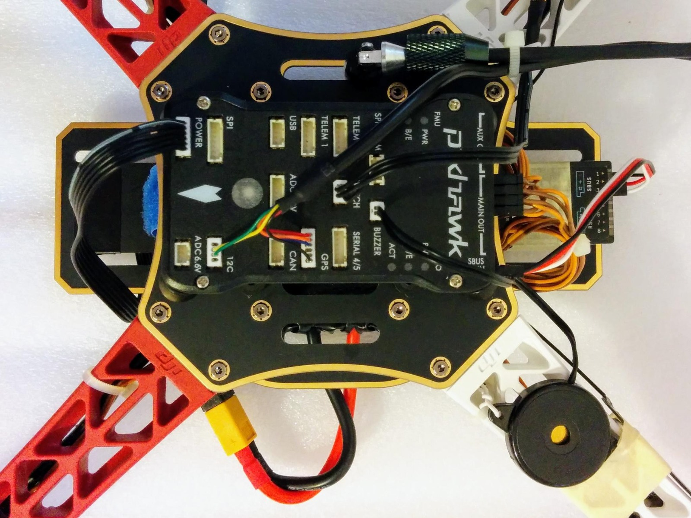
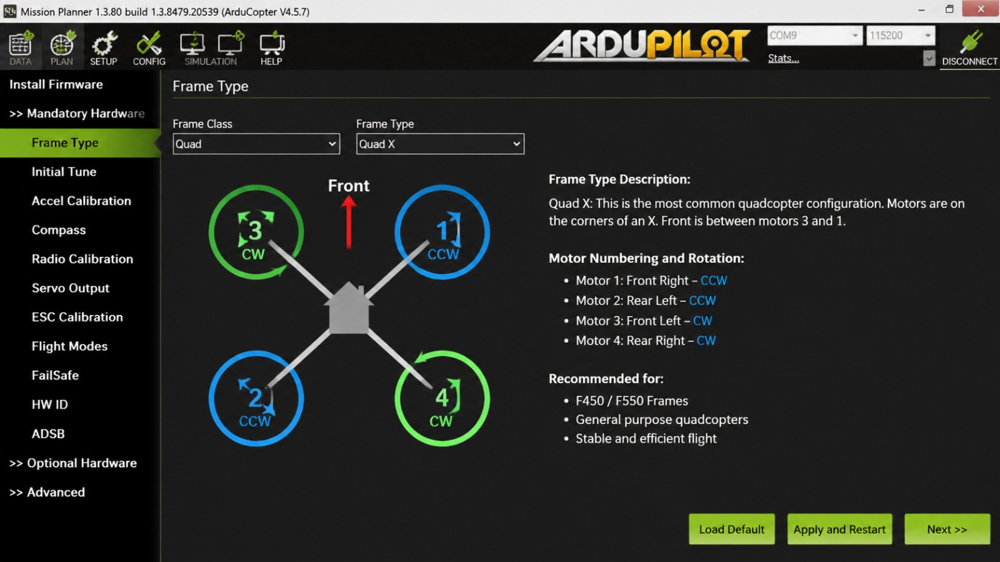
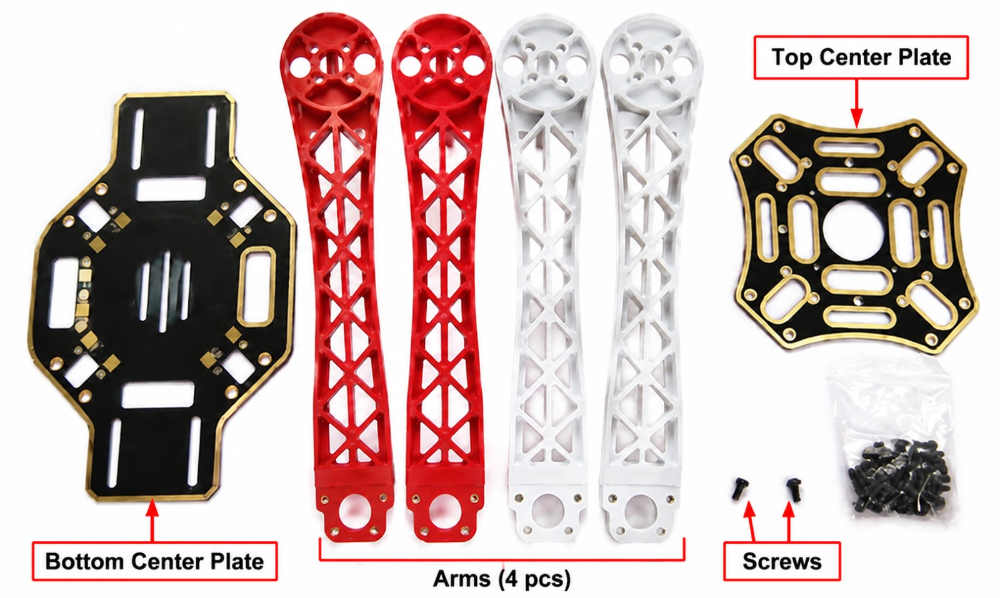
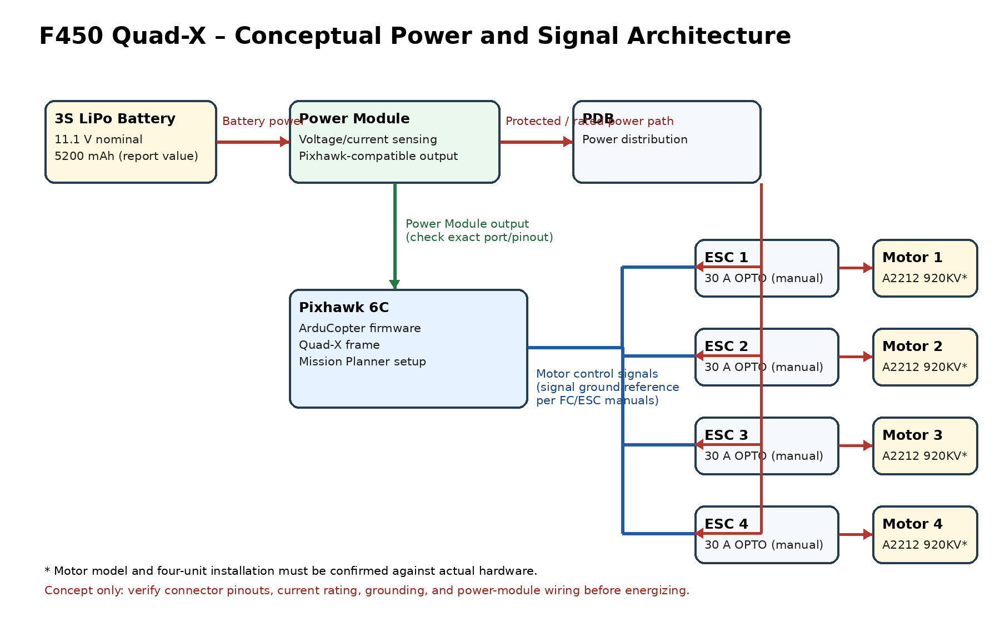

# Aufbau und Erprobung eines F450-Quadcopters (Drohne)

> **Projektstatus:** Der Quadrocopter wurde aufgebaut, konfiguriert und Testflüge wurden durchgeführt. Die bereitgestellten Unterlagen dokumentieren einen Pixhawk-6C-Aufbau sowie ArduCopter 4.5.7 / Mission Planner mit Quad-X-Konfiguration. Betaflight wurde nach Angaben des Projektverantwortlichen ebenfalls im Projekt verwendet. Die konkrete Zuordnung von Betaflight zu einer bestimmten Flugsteuerung bzw. Projektphase ist in den bereitgestellten Unterlagen nicht separat dokumentiert.

## Projektübersicht

Aufbau, Integration, Konfiguration und Erprobung eines F450-Quadcopters in Quad-X-Konfiguration. Der Schwerpunkt liegt auf mechanischer Montage, Leistungs- und Signalverdrahtung, Integration der Antriebskomponenten, Flight-Controller-Konfiguration sowie praktischen Testflügen und Fehlersuche.

## System und Komponenten

- Rahmen: F450 Quad-X
- Flight Controller: Pixhawk 6C (laut Projektbericht)
- Flugsteuerungs-Firmware: ArduCopter 4.5.7 (im Mission-Planner-Screenshot dokumentiert)
- Konfigurationssoftware: Mission Planner
- Zusätzlich verwendete Konfigurationssoftware: Betaflight (nach Angabe des Projektverantwortlichen; genaue Hardware-/Phasenzuordnung nicht dokumentiert)
- Motoren: A2212, 920 KV (laut beigefügtem Motordatenblatt)
- ESCs: Lumenier 30A BLHeli_S OPTO (laut beigefügtem ESC-Handbuch)
- Akku: 3S LiPo, 11.1 V nominal, 5200 mAh (Wert aus dem Projektbericht; tatsächlichen Akkuaufdruck prüfen)

Die Herstellerunterlagen beschreiben die technischen Daten der jeweiligen Modelle. Sie belegen nicht allein, dass jede Komponente in genau dieser Ausführung am fertigen Copter verbaut wurde.

## Durchgeführte Arbeiten

### Mechanischer Aufbau und Hardware-Integration
- Montage der F450-Rahmenstruktur.
- Integration und Befestigung der Flugsteuerung.
- Verdrahtung und Integration der Leistungs- und Signalelektronik.
- Integration der BLDC-Motoren und ESCs.

### Flight Controller und Konfiguration
- Konfiguration des Pixhawk-6C-Systems mit ArduCopter.
- Auswahl der Quad-X-Rahmenkonfiguration in Mission Planner.
- Betaflight wurde zusätzlich im Projekt verwendet; die genaue Zuordnung zu Hardware und Projektphase ist in den vorliegenden Unterlagen nicht festgehalten.

### Inbetriebnahme und Erprobung
- Inbetriebnahme des Quadcopters.
- Durchführung von Testflügen (vom Projektverantwortlichen bestätigt).
- Systematische Überprüfung und Fehlersuche an elektrischen und mechanischen Komponenten.

**Hinweis zu den Testergebnissen:** Testflüge wurden durchgeführt. Fluglogs, konkrete Flugzeiten, Leistungswerte oder quantitative Messergebnisse wurden im bereitgestellten Paket jedoch nicht mitgeliefert und werden deshalb hier nicht behauptet.

## Dokumentierte Bilder

### Flight Controller auf dem Rahmen



### Mission Planner – ArduCopter 4.5.7, Quad-X



### F450-Rahmenteile – Referenzbild

Das folgende Bild zeigt Rahmenteile/Komponenten als Referenz und ist kein Nachweis eines fertig montierten Copters.



## Elektrische Architektur



Das Diagramm ist ein konzeptionelles Blockdiagramm, kein freigegebener Verdrahtungsplan. Die konkrete Power-Module-Verschaltung, Pinbelegung, Strombelastbarkeit, Masseführung und ESC-Signal-Kompatibilität müssen anhand der exakten Hardware-Handbücher geprüft werden.

## Technische Prüfung und Sicherheit

- Vor jedem Betrieb Akku, Polarität, Leitungsquerschnitt, Steckverbindungen und Strombelastbarkeit prüfen.
- Bei Konfiguration und Motorprüfungen Propeller entfernen.
- Pixhawk 6C nur über eine dafür vorgesehene, kompatible Stromversorgung gemäß Hersteller-Pinout versorgen.
- Der im ESC-Handbuch beschriebene OPTO-ESC besitzt keinen BEC-Ausgang. Keine 5-V-Versorgung durch den ESC annehmen.
- Testflüge nur in geeigneten, zulässigen Bereichen und unter Einhaltung der geltenden Vorschriften durchführen.

## Repository-Struktur

```text
f450-quadcopter/
├── README.md
└── docs/
    ├── photos/
    ├── diagrams/
    └── references/
```

## Autor

Mohamed Aly
